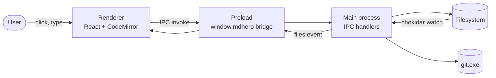
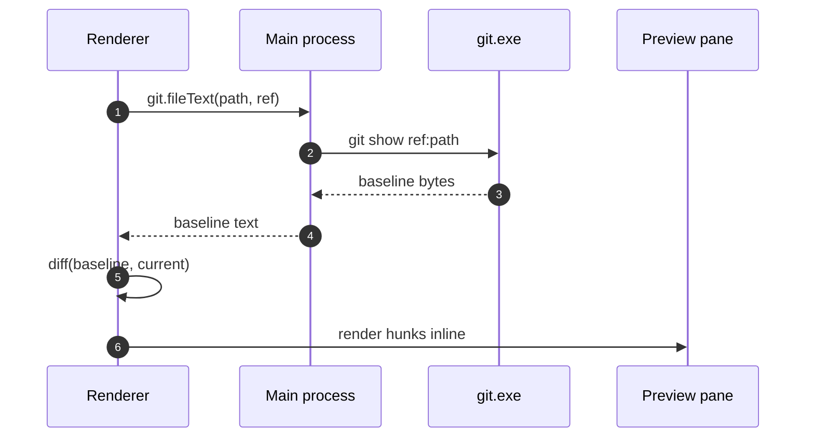

# MdHero Architecture

A high-level view of how MdHero is wired internally. Useful both as an example of what MdHero renders well and as documentation for anyone curious about the design.

## Process model

MdHero is an Electron application. The main process holds anything that touches the filesystem, git, or the OS. The renderer is a sandboxed React app that talks to the main process exclusively through a typed preload bridge.

## Diff pipeline

The block-level diff overlay is the anchor feature. When you point the preview at a git ref, MdHero spawns `git.exe` to read the historical version of the file, computes block-level hunks, and renders the result inline.

## Why this matters for AI-assisted authoring

When an AI coding agent rewrites a document, you want to see *which paragraphs it touched* — not a wall of red-and-green character diffs. The block-level overlay groups changes by the markdown block they belong to (heading, paragraph, list item, code block, mermaid diagram), so review feels closer to reading the rendered output than to reading a diff.

## Anchor features

- Folder-based markdown workspace with file tree, search, wiki-links, tags.
- Live preview with syntax highlighting and Mermaid diagrams (this page is one).
- **Block-level diff against any git ref, rendered into the preview itself.**
- Side-by-side edit and preview modes.
- Cross-platform, fully offline, no telemetry.
